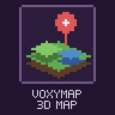

<p align="center"></p>

# VoxyMap LTS

[](https://www.minecraft.net/)
[](https://fabricmc.net/)
[](https://adoptium.net/)
[](gradle.properties)
[](LICENSE)

VoxyMap LTS is a maintained client-side fork of [3D Maps Voxy Addon](https://github.com/raben12paste/3D-maps-Voxy-Addon). It opens a full-screen 3D map backed by Voxy LOD data for Minecraft 26.3.

**Руководство / User guide:** [Русский](docs/USER_GUIDE_RU.md) · [English](docs/USER_GUIDE_EN.md)

## Русский

### Что это

VoxyMap LTS — поддерживаемый клиентский форк 3D Maps Voxy Addon для Minecraft 26.3. Он открывает полноэкранную трёхмерную карту на данных LOD из Voxy и добавляет миникарту в углу экрана. На сервер мод ставить не нужно.

### Требования

- Minecraft `26.3`, Java `25`, Fabric Loader `0.19.5` или новее, Fabric API.
- Voxy `0.2.20-beta` или новее для 26.3 ([Modrinth](https://modrinth.com/mod/voxy)), ему нужен Sodium. Перед переходом со старой версии Voxy сделайте копию `.minecraft/.voxy`.
- Игра должна работать на OpenGL. Из шейдерных модов Voxy поддерживает Iris 1.11.7, с Iris 1.12 и новее не работает.
- Необязательно: Iris, Xaero's World Map, Litematica Plus LTS, Spatial GUI, Mod Menu.

### Возможности

Подробное описание: [справочник возможностей](docs/USER_GUIDE_RU.md#справочник-возможностей).

| Раздел | Что есть |
|---|---|
| Полноэкранная карта | 3D-вид на LOD Voxy, 2D-карта (`V`), погода и время на карте, модели игроков и мобов, панель инструментов, компас, линейка масштаба, меню по ПКМ, скриншот (`F2`) |
| Нижний мир и руды | Снятие бедроковой крыши целыми полигонами, ванильные руды в LOD закрашиваются серым |
| Маршруты | До метки или любой точки: ходьба, плавание, лодка и элитры, карточка с расстоянием и временем, перестроение при сходе с пути |
| Метки | Постановка на видимый блок, цвета и символы, лучи маяка, точки смерти, общий доступ в чате, импорт из Xaero's Minimap и JourneyMap |
| Миникарта | На клиенте по загруженным чанкам, квадратная или круглая, режим пещер, строки под картой, радар, слои слайм-чанков, спавна мобов и биомов |
| Совместная игра | Сервер синхронизации меток, обмен картой по одноразовому коду, поддержка VanillaSquad |
| Интеграции | Xaero's World Map, Litematica Plus LTS, Spatial GUI |

Переводы: английский, русский, испанский (Испания и Мексика), польский.

### Управление на карте

| Клавиша | Действие |
| --- | --- |
| `M` / `Esc` | Закрыть карту |
| ЛКМ, перетаскивание | Двигать карту |
| Двойной ЛКМ по рельефу | Поставить метку на видимую поверхность |
| ЛКМ по метке | Выбрать; повторный клик или `Enter` — переименовать |
| `Delete` / `Ctrl+Z` | Удалить выбранную метку / вернуть удалённую |
| ПКМ, перетаскивание | Поворот и наклон камеры |
| Колесо / `+` / `-` | Масштаб к курсору |
| `W/A/S/D` или стрелки | Двигать камеру, `Shift` — быстрее |
| `V` | Переключить 3D- и 2D-карту |
| `G` | Перейти к введённым координатам |
| `N` (клавиша метки) | Поставить метку под курсором |
| ПКМ, клик | Меню: метка, временная метка, копировать координаты, телепорт |
| `H` | Подсказка по клавишам |
| `C` | Вернуться к игроку |
| `O` | Панель объектов |
| `F` | Следить за выбранным игроком; ручное движение отменяет слежение |
| `F2` | Скриншот карты без интерфейса |

### Управление в обычной игре

| Клавиша | Действие |
| --- | --- |
| `Z` (удерживать) | Увеличить миникарту |
| `=` / `-` | Масштаб миникарты |
| `N` | Поставить метку на месте игрока |
| `U` | Список меток |
| не назначена | Временная метка туда, куда смотрите |
| `Tab` (удерживать) | Головы на миникарте, если выбран режим показа при зажатом `Tab` |

### Настройки

Группы одинаковы в панели «Настройки» на карте и в экране Mod Menu (Моды → VoxyMap LTS → Настроить). В обоих есть поиск, подсказки и сброс.

| Группа | Что внутри |
| --- | --- |
| Общие | Пауза в одиночной игре, скорость камеры, освещение карты, погода на карте, LOD Voxy вне карты, анимации интерфейса, подавление тумана (вкл., только Нижний мир, выкл.), скриншот карты; при установленном Spatial GUI: M открывает окно карты, 3D-вид в этом окне |
| Слои карты | Метки, метки Верхнего мира в Незере и обратно, точки смерти, направление взгляда, модели на 3D-карте; игроки, флаги и карта VanillaSquad — только при подключении к VanillaSquad; схемы — только при установленном Litematica Plus LTS |
| Вид меток | Где показывать новые метки, форма и размер значка, метки в мире, фон и размер подписи, расстояние, дальность, лучи маяка |
| Миникарта | Миникарта, вращение, цвета, форма, размер, угол, масштаб, положение, прозрачность, затемнение ночью, режим пещер, при открытом экране, сетка чанков |
| Под миникартой | Координаты, координаты Незера / Верхнего мира, биом, освещённость, время, чанк, направление |
| Радар миникарты | Враждебные, нейтральные, мирные мобы, предметы, игроки, значки |
| Наложения на карту | Слайм-чанки, места спавна мобов, цвета биомов |
| Синхронизация и обмен | Адрес, пароль и статус синхронизации, «Поделиться картой», «Получить карту» |
| Диагностика | Загрузились ли патчи шейдеров Voxy |

Настройки хранятся в `config/voxymap.properties`, локальные метки в `config/voxymap-waypoints.properties`, адрес и пароль синхронизации в `config/voxymap-sync.properties`. Заметки о настройках: [раздел в руководстве](docs/USER_GUIDE_RU.md#заметки-о-настройках).

### Сервер синхронизации

`voxymap-sync-server` — отдельная программа без Minecraft и зависимостей для общих меток и обмена картой. Трафик идёт по HTTP без шифрования: сервер рассчитан на локальную сеть или доверенную компанию.

```powershell
.\gradlew.bat syncServerJar
java -jar build\libs\voxymap-sync-server-<версия>.jar --bind 0.0.0.0 --port 8642 --password пароль
```

Параметры и обмен картой: [раздел в руководстве](docs/USER_GUIDE_RU.md#сервер-синхронизации-и-обмен-картой).

### Сборка

```powershell
.\gradlew.bat clean build --warning-mode all
```

В `build/libs/` появятся два jar, ставить нужно только один:

- `voxy-map-<версия>.jar` — основная версия, без меток игроков с веб-карты VanillaSquad;
- `voxy-map-<версия>-player-markers.jar` — то же самое плюс эти метки.

Перед выпуском пройдите [чек-лист проверки в игре](docs/runtime-regression-checklist.md).

### Ограничения

- Карта показывает только то, что уже есть у Voxy: чанки не загружаются, неисследованное не раскрывается. Миникарта так же видит только загруженные чанки.
- Если новая версия Voxy изменит устройство своих шейдеров, снятие крыши Нижнего мира и маска руд отключатся сами, а игра продолжит работать. Состояние видно в группе «Диагностика».
- Сборка и тесты не заменяют проверку в игре с теми же версиями Voxy, Iris, Sodium и Xaero, что в целевом профиле.

Полный список: [известные ограничения](docs/USER_GUIDE_RU.md#известные-ограничения).

---

## English

### What It Is

VoxyMap LTS is a maintained client-side fork of 3D Maps Voxy Addon for Minecraft 26.3. It opens a full-screen 3D map backed by Voxy LOD data and adds a minimap in the screen corner. The mod does not need to be installed on the server.

### Requirements

- Minecraft `26.3`, Java `25`, Fabric Loader `0.19.5` or newer, Fabric API.
- Voxy `0.2.20-beta` or newer for 26.3 ([Modrinth](https://modrinth.com/mod/voxy)), which needs Sodium. Back up `.minecraft/.voxy` before moving from an older Voxy.
- The game has to run on OpenGL. With shaders Voxy supports Iris 1.11.7; Iris 1.12 and newer break it.
- Optional: Iris, Xaero's World Map, Litematica Plus LTS, Spatial GUI, Mod Menu.

### Features

A detailed description: [feature reference](docs/USER_GUIDE_EN.md#feature-reference).

| Area | What is there |
|---|---|
| Full-screen map | 3D view from Voxy LODs, a 2D map (`V`), map weather and time, player and mob models, a toolbar, compass, scale bar, right-click menu, screenshot (`F2`) |
| Nether and ores | Whole-quad roof removal, vanilla ores in LODs drawn plain grey |
| Routes | To a waypoint or any point: walking, swimming, boat and elytra legs, a card with distance and time, re-planning when you leave the route |
| Waypoints | Placed on the visible block, colours and symbols, beacon beams, death points, sharing in chat, import from Xaero's Minimap and JourneyMap |
| Minimap | Client-side from loaded chunks, square or circle, cave view, lines under the map, radar, slime chunk, mob spawn and biome overlays |
| Multiplayer | A waypoint sync server, map sharing over a one-time code, VanillaSquad support |
| Integrations | Xaero's World Map, Litematica Plus LTS, Spatial GUI |

Translations: English, Russian, Spanish (Spain and Mexico), Polish.

### Controls on the Map

| Control | Action |
| --- | --- |
| `M` | Open or close the map; the opening binding can be changed in Controls |
| Left mouse drag | Move the map |
| Double left click terrain | Add a waypoint on the exact visible Voxy surface |
| Left click a waypoint | Select it; click again or press `Enter` to rename |
| `Delete` / `Ctrl+Z` | Delete the selected waypoint / undo deletion |
| Right mouse drag | Rotate and tilt the camera |
| Mouse wheel / `+` / `-` | Zoom toward the cursor |
| `W/A/S/D` or arrow keys | Move the camera |
| `Shift` | Move faster |
| `C` | Center on the player |
| `O` | Open or close the Objects panel |
| `F` | Follow or stop following the selected player; manual movement stops following |
| `V` | Switch between the 3D and the 2D map |
| `G` | Go to typed coordinates |
| `N` (add-waypoint key) | Add a waypoint under the cursor |
| Right click | Context menu: waypoint, temporary waypoint, copy coordinates, teleport |
| `H` | Keyboard shortcuts overlay |
| `F2` (screenshot key) | Save a screenshot of the map without the interface: for one frame every panel, the HUD and chat are hidden (and the markers too, unless the Map screenshot setting is "With markers"), then restored |
| `Esc` | Close the map |

### Controls During Normal Gameplay

| Control | Action |
| --- | --- |
| `Z` (hold) | Enlarge the minimap; rebindable in Controls as "Enlarge minimap (hold)" |
| `=` / `-` | Minimap zoom in / out |
| `N` | Add a waypoint where you stand |
| `U` | Waypoint list |
| unbound | Temporary waypoint where you look |
| Player-list key (`Tab`, hold) | Show player and mob heads on the minimap when the radar icons setting is "Heads while Tab is held" |

### Configuration

Settings are grouped the same way in the map's **Settings** panel and in the Mod Menu screen (Mods -> VoxyMap LTS -> Configure). Both have search, hints and reset buttons.

| Group | Contents |
| --- | --- |
| General | Pause in singleplayer, camera speed, map lighting (auto, morning, day, evening, night), map weather (clear, rain, thunder, auto), Voxy LODs outside the map, interface animations, fog suppression (on, Nether only, off), map screenshot (no interface / with markers); with Spatial GUI installed: M opens the map window, 3D view in that window |
| Map layers | Waypoints, Overworld waypoints in the Nether and back, death points, your view direction, models on the 3D map; VanillaSquad players / flags / map, shown only while connected to the VanillaSquad server; schematics, shown only with Litematica Plus LTS installed |
| Waypoint look | Where new waypoints show, icon shape and size, waypoints in the world (off, icons, name when aimed at, always), label background and size, distance, range, beacon beams |
| Minimap | Minimap, rotation, colours, shape, size, corner, zoom, position, opacity, darker at night, cave view, with a screen open, chunk grid |
| Under the minimap | Coordinates, Nether / Overworld coordinates, biome, light level, day and time, chunk, facing |
| Minimap radar | Hostile, neutral, passive mobs, dropped items, players, icons |
| Map overlays | Slime chunks, where mobs can spawn, biome colours |
| Sync and sharing | Sync address, password and status, share map, receive map |
| Diagnostics | Whether the Voxy shader patches loaded |

Settings are stored in `config/voxymap.properties`, local waypoints in `config/voxymap-waypoints.properties`, the sync address and password in `config/voxymap-sync.properties`. Settings notes: [section in the guide](docs/USER_GUIDE_EN.md#settings-notes).

### Sync Server

`voxymap-sync-server` is a separate program with no Minecraft or other dependency for shared waypoints and map sharing. Traffic is plain HTTP with no encryption: it is meant for a trusted LAN or a small group of friends.

```powershell
.\gradlew.bat syncServerJar
java -jar build\libs\voxymap-sync-server-<version>.jar --bind 0.0.0.0 --port 8642 --password mysecret
```

Arguments and map sharing: [section in the guide](docs/USER_GUIDE_EN.md#waypoint-sync-server).

### Building

```powershell
.\gradlew.bat clean build --warning-mode all
```

`build/libs/` gets two JARs; install only one:

- `voxy-map-<version>.jar` is the main build, without the VanillaSquad web-map player markers;
- `voxy-map-<version>-player-markers.jar` is the same plus those markers.

Before publishing, complete the [runtime regression checklist](docs/runtime-regression-checklist.md).

### Limitations

- VoxyMap only displays terrain already available to Voxy; it does not load chunks or reveal unexplored server data. The minimap likewise sees only loaded chunks.
- If a newer Voxy changes its shader layout, the Nether roof removal and ore mask switch themselves off and the game keeps working. The Diagnostics group shows their state.
- Build and package checks do not replace an in-game test with the exact Voxy, Iris, Sodium, and Xaero versions in the target profile.

Full list: [known limitations](docs/USER_GUIDE_EN.md#known-limitations).

## Лицензия / License

Original project and implementation: [raben12paste](https://github.com/raben12paste). LTS maintenance and Minecraft 26.x compatibility: `LTS_Server`.

Licensed under the MIT License. See [LICENSE](LICENSE).
